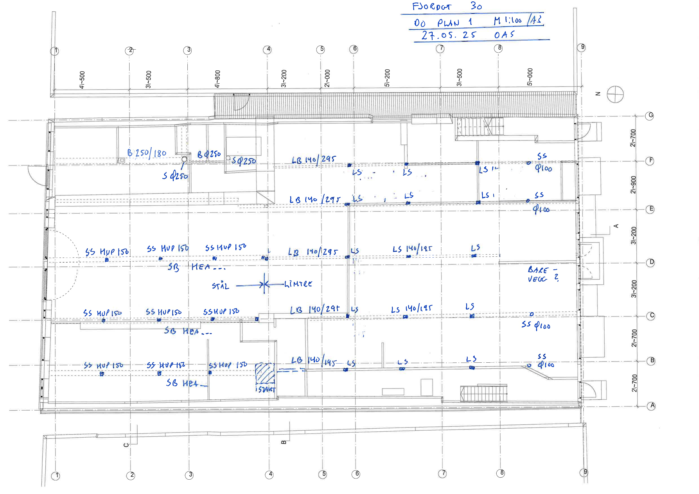
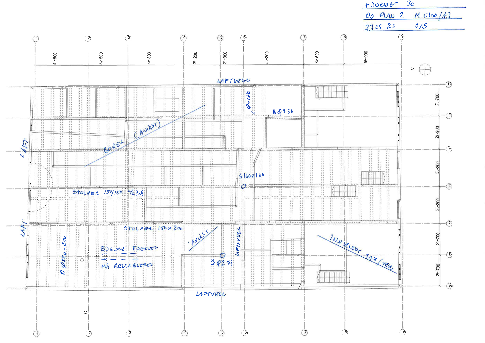
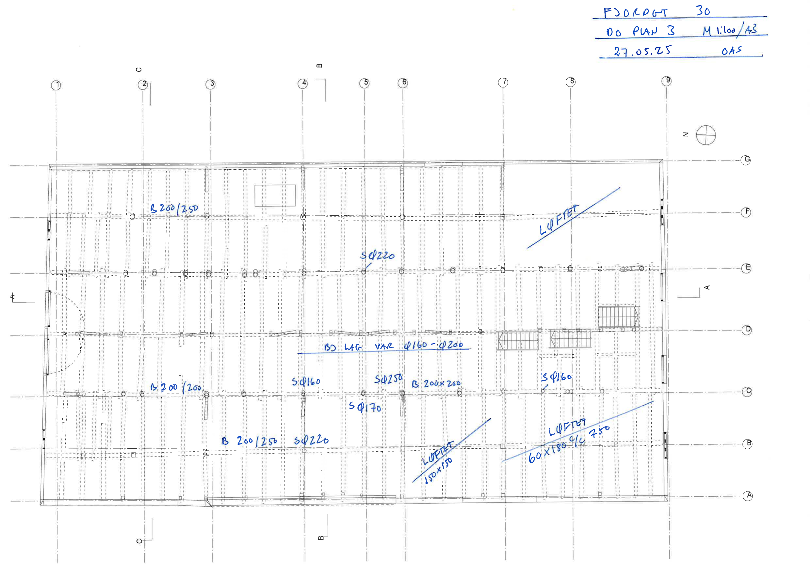
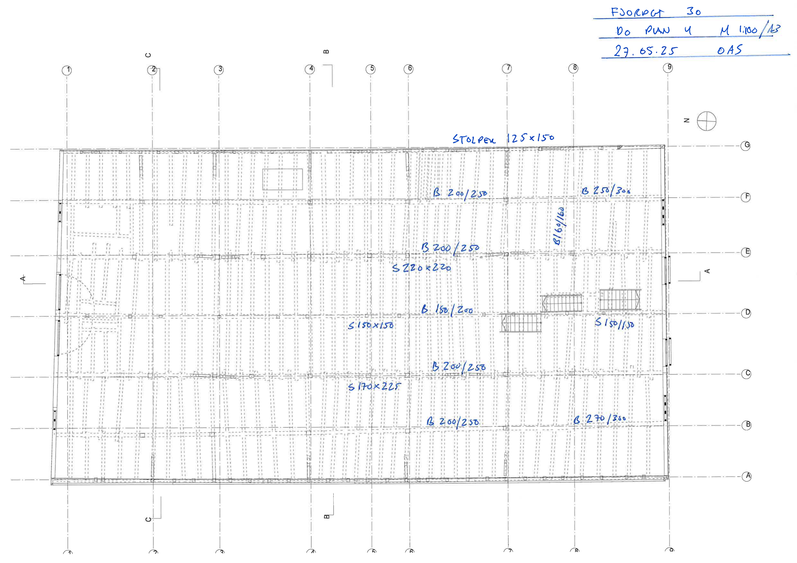
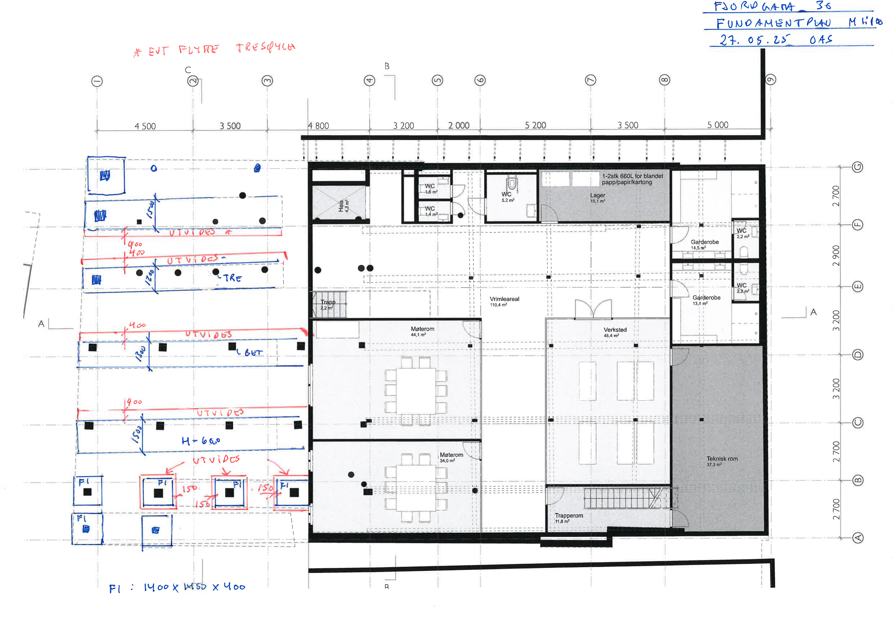

# Tegninger for beregninger — Harboe og Leganger, 27.05.2025

Tegningsvedlegg til beregningene i notat av 13.06.2025 (`2025-06-13_notat_fjordgata30.md`). PDF-en har ingen tekstlag — innholdet ligger i selve tegningene.

