# Fjordgata 30 — Vurdering av bærende konstruksjoner

**Sivilingeniørene Harboe og Leganger AS**\
Rådgivende ingeniører i byggeteknikk\
Elvegt. 7, 7012 Trondheim · 73 99 28 30 · firmapost@h-l.no

**Trondheim 13.06.2025**\
**Til:** Kodeworks Eiendom AS

---

## Bakgrunn

På oppdrag av Kodeworks Eiendom AS har Siv Ing Harboe og Leganger AS gjort en registrering og vurdering av konstruksjonen i Fjordgata 30. Det foreligger planer for ombygging og rehabilitering av bryggen.

### Lastforutsetninger

| Last | Verdi |
|---|---|
| Egenvekt takkonstruksjon (trekonstruksjon, lett taktekking) | 0,8 kN/m² |
| Egenvekt etasjeskillere inkl. konstruksjon og lettvegger | 1,5 kN/m² |
| Snølast tak | 2,8 kN/m² |
| Nyttelast kontorarealer | 3,0 kN/m² |

Materialer: heltre C18, limtre GL30c, stålkvalitet S355.\
Forutsatt brannkrav R60 på hovedbæring og sekundærbæring iht. brannkonsept fra Rambøll.

For kontroll av fundamenter er det brukt jordparametre for løs sand. Dette bør verifiseres av geotekniker. Ved kontroll av fundamenter er det forutsatt minimum 150 mm oppfylling rundt fundamentet.

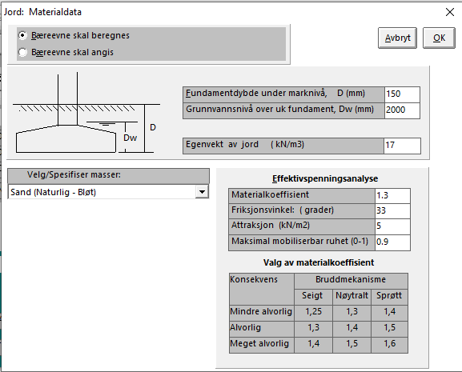

---

## Fundamentering

Fundamentene i nordre halvdel av bygget mot elva er synlige for inspeksjon. Fundamenter i bakre del er skjult og følgelig ikke vurdert.

Fundamentene er utført i hovedsak som bunnbjelker/banketter, med noen punktfundamenter i randsonen. Fundamentene ligger med underkant på terrengnivå — de er ikke gravd ned. Dette er uheldig både med tanke på bæreevne og utvasking under fundamenter.

Fundamentene bør derfor understøpes i randsonen hvor det er utvasket, og omfylles med stabil masse for å unngå mer utvasking under fundamentene.

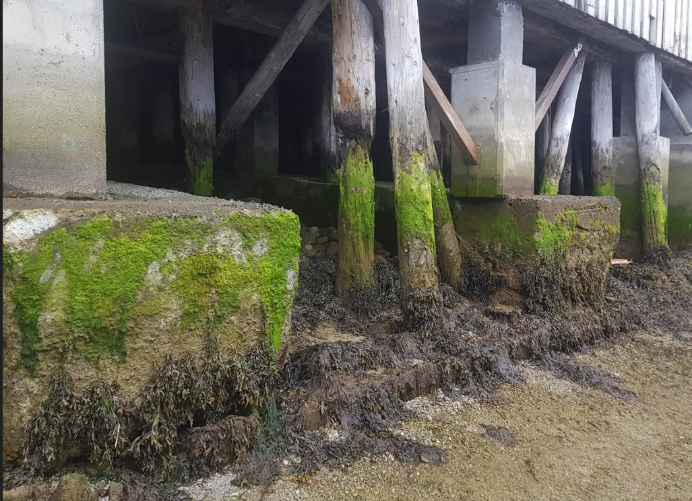

Betongsøylene i akse C og D samt tresøylene i akse E og F er plassert veldig eksentrisk på banketten. Dette gjør at hele bankettbredden ikke kan utnyttes. Søylene står helt på kanten — siden søyleplasseringen er låst i forhold til bærelinje videre oppover i bygget, er det banketten som er feilplassert når dette ble utført.

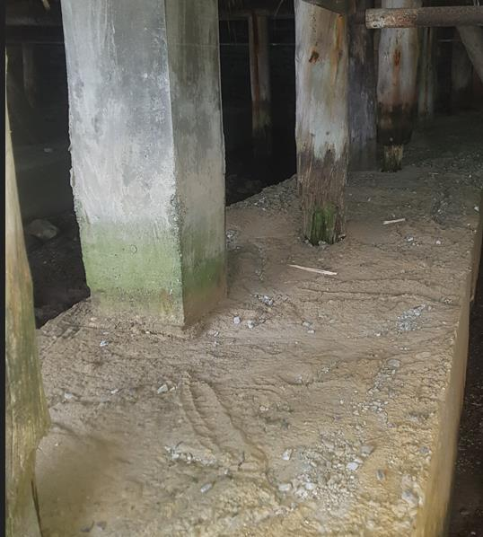

---

## Lastberegning og kontroll av fundamentstørrelser

For å vurdere fundamenter og risiko for fremtidige setninger er det gjort en lastberegning og kontrollberegning av fundamentstørrelser og bankettbredder. Armeringsmengder i betongkonstruksjonene er ukjent og kan derfor ikke kontrolleres.

### Banketter akse C, D, E og F

Grunntrykk under banketter er maks **104 kN/m²** (egenvekt fundament ikke medregnet, sentrisk belastning) — ansees som ok.

Men fundamentet er skjevbelastet, og da blir trykkoverføringen mot grunnen en helt annen. I akse C og D står fundamentene helt på kanten — overført grunntrykk blir **258 kN/m² vs. bæreevne 101 kN/m²**.

Skjevt belastende banketter bør utvides slik at effektiv fundamentbredde blir tilstrekkelig. Utvidelsen bør være på minimum **0,4 m**, armeres tilstrekkelig og forankres inn i eksisterende bankett med innboring og gysing av armering.

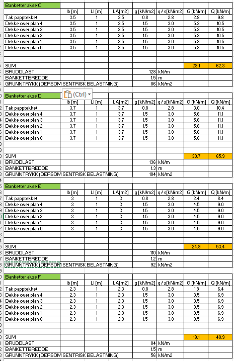

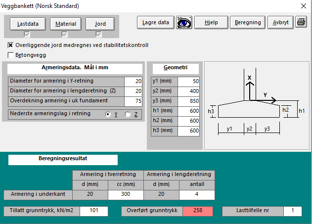

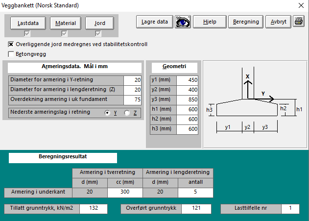

### Fundamenter akse B

Grunntrykk under punktfundament er høyere enn under banketter. Ved kontrollberegning kommer vi til at bæreevnen er overskredet. For at grunntrykket ikke skal overskride bæreevnen må fundamentene utvides **150 mm**. Utvidelsen gjøres som for bankettene med påstøp som forankres inn i eksisterende fundament.

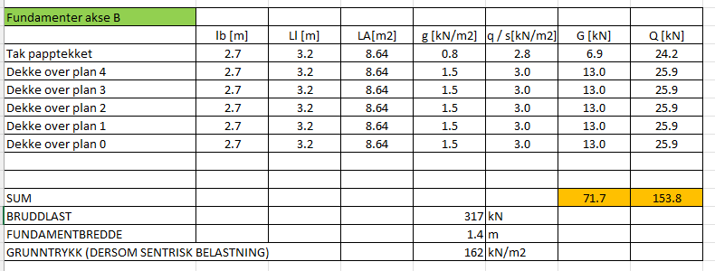

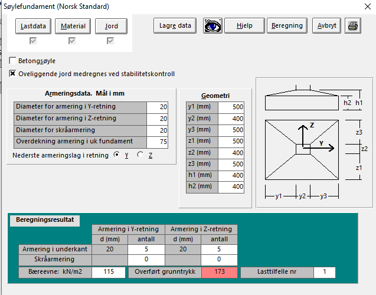

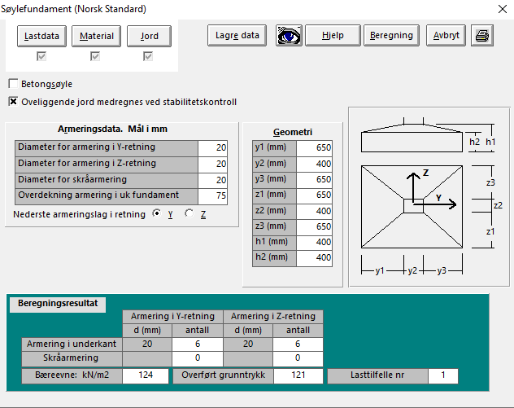

### Fundamenter under tregulv mot Fjordgata

Det er her etablert nye fundamenter, med varierende størrelse (0,7×0,7 – 0,9×0,9). Søyler er stedvis plassert eksentrisk på fundamentene.

Lastberegning og beregning av fundamenter gir at det må etableres nye fundamenter med mål **2,1×2,1 m**, sentrisk under søylene.

### Øvrige tiltak på fundamenter

- Det bør etableres betongfundamenter under tresøylene under bryggen som i dag ikke har betongfundament. Disse tresøylene bærer i dag kun dekket på plan 1. Alternativt kan det legges en utvekslingsbjelke i stål eller tre oppunder dekket, og føre nye søyler ned på eksisterende fundamenter.
- I forbindelse med ny heissjakt må det etableres heisgrube med tilstrekkelig fundament for å ta opp de laster som føres inn på heissjakten. Gruben må utføres vanntett.
- I forbindelse med etablering av ny lyssjakt bør det etableres ny avstiving av bryggen i form av kryssavstiving eller skråstag. Denne avstivingen må forankres ned i fundament. Fundament etableres ved å forbinde de eksisterende fundamentene i akse C og E.

---

## Bærekonstruksjoner plan 0 (under bryggen)

Flere av tresøylene har store skader / råteskader. Disse må skiftes ut med nye i tre eller betong.

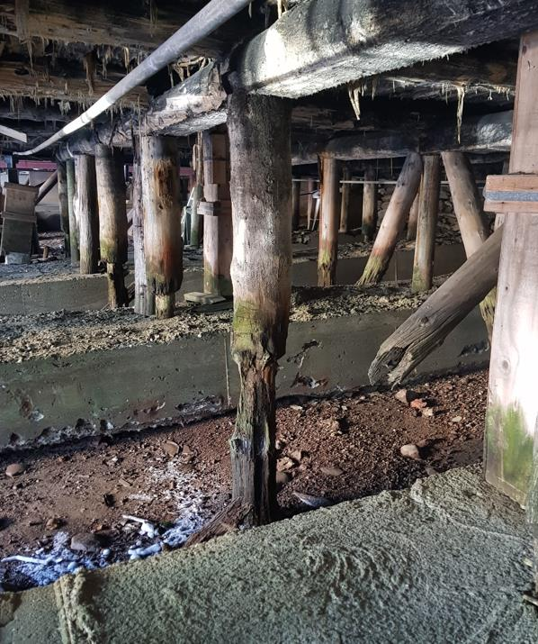

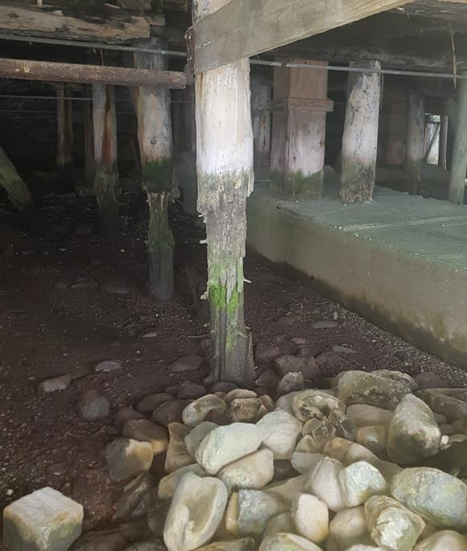

---

## Bærekonstruksjoner plan 1–4

For plan 1–4 er det gjort registrering av dimensjoner på synlige søyler og bjelker. For plan 2–4 er det veldig varierende heltredimensjoner. På plan 1 er opprinnelig trekonstruksjon delvis skiftet ut med konstruksjoner i stål og limtre. Stålkonstruksjonen består av bjelke **HEA 280** og søyler **HUP 150x150x5** (utvendig størrelse målt).

Oppsummert:

- **Stålkonstruksjon på plan 1** er tilstrekkelig dimensjonert.
- **Limtrekonstruksjon på plan 1 og plan 0** er underdimensjonert og må enten skiftes i sin helhet eller forsterkes.
- **Bjelkelag av rundåser** bør ha minimum dimensjon ø220 for spennvidde 2,7 m og ø250 for spennvidde 3,2 m for å tilfredsstille brannkrav R60.
- **Hovedbjelker i bokstavaksene** må forsterkes eller skiftes ut ved spennvidder over 2,8 m — både mht. bæreevne og brannmotstand.
- **Heltresøyler** må være ca. ø250 i plan 1 og 2, ca. ø220 i plan 3 og 4, for å tilfredsstille brannkrav.

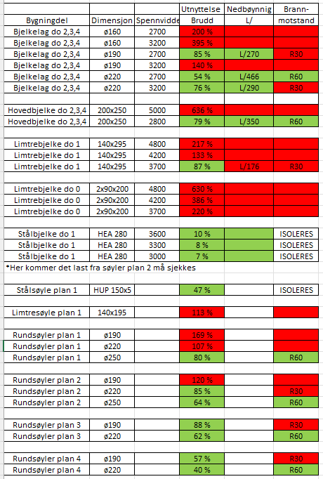

---

## Bærekonstruksjoner tak

Takkonstruksjon består av taksperrer **60x130 cc 800–900** lagt opp på langsgående bjelker **150x200**. Takkonstruksjon er underdimensjonert ift. dagens snølast og anbefales bygd opp på nytt da det uansett skal gjøres store endringer på taket.

---

## Stabilitet/skjevstilling

Bryggen har i dag store helningsavvik i tverretning, og systemet for å ta opp disse skjevstillingslastene samt vindlaster synes ufullstendig og uoversiktlig. I gavlvegger er det store åpninger.

I forbindelse med større åpning i dekkene / lyssjakt anbefales det etablert avstiving i område akse 4 og 6+ i form av stålkryss for å ta opp skjevstillingslaster og vindlaster. Selv om mye av skjevstillingen er tenkt forsøkt rettet opp, er det på grunn av åpningen i dekket kombinert med få muligheter for avstiving i gavler gunstig å etablere avstiving her.

Mulig plassering av avstiving, plan 1 og oppover — se tegning. I lengderetningen er det mindre skjevheter, og lastene kan tas opp av ytterveggene som er tette og består delvis av laft.

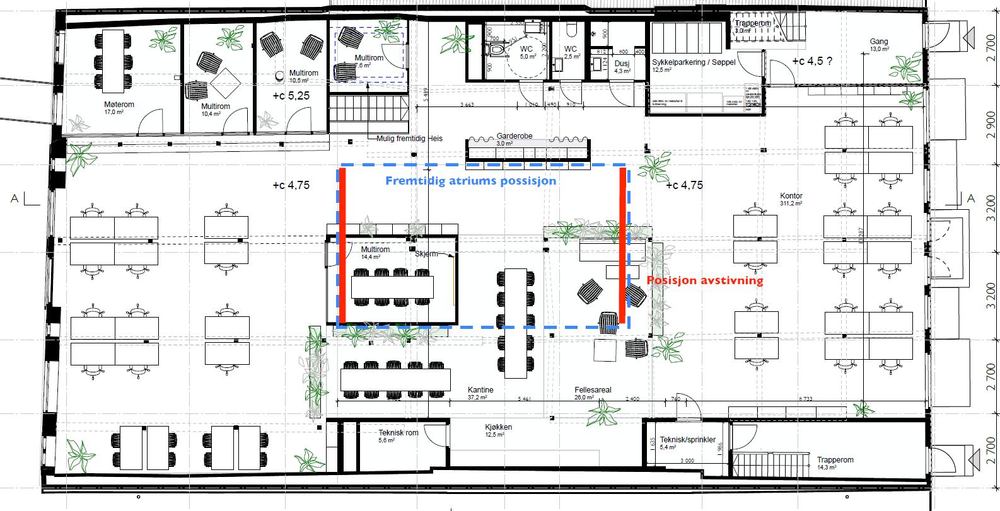

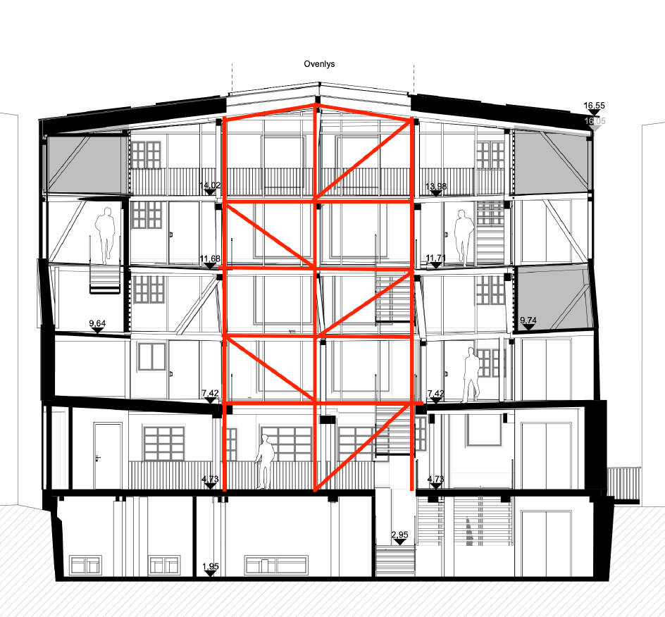

---

## Konklusjon — hovedgrep for konstruksjonssikkerhet

- Fundamenter bør utbedres mht. størrelse, undergraving og skjevbelastning.
- Råteskadede søyler under bryggen må skiftes ut.
- Limtrekonstruksjon på plan 0 og plan 1 er underdimensjonert og må utbedres.
- Varierende dimensjoner på heltrekonstruksjon plan 2–4. Enkeltelementer har for liten dimensjon mht. bæreevne og brannmotstand.
- Det bør etableres ny avstiving i tverretning i forbindelse med ny lyssjakt.

**Vedlegg:** Oversiktstegninger med dimensjoner.

---

**For Siv Ing Harboe og Leganger AS**\
Ole Stenmo\
Siv Ing — MRIF
