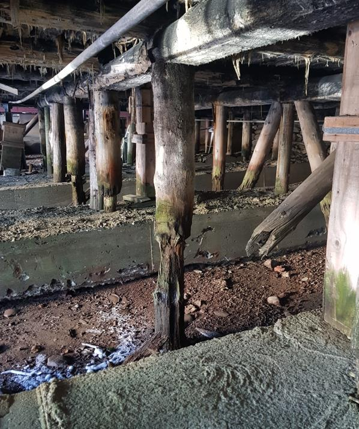
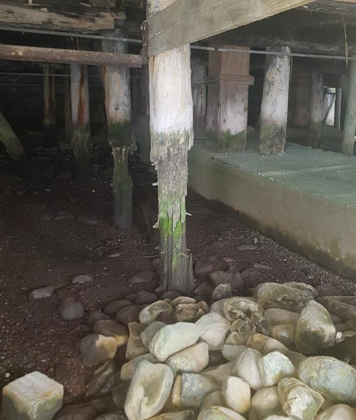
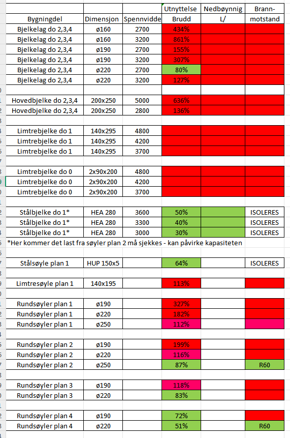
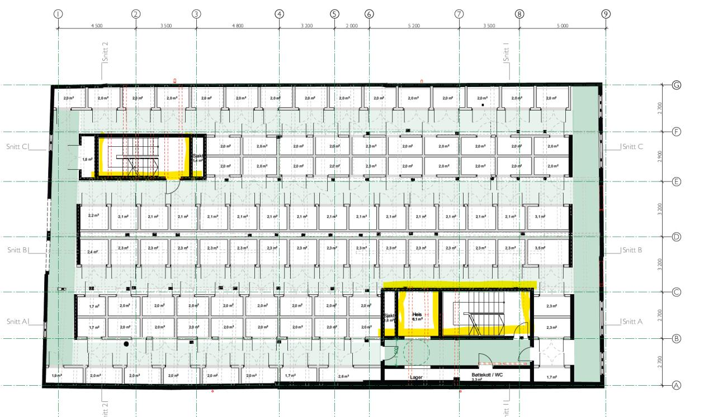

# Fjordgata 30 — Vurdering av bærende konstruksjoner (ombygging til minilager)

**Sivilingeniørene Harboe og Leganger AS**\
Rådgivende ingeniører i byggeteknikk\
Elvegt. 7, 7012 Trondheim · 73 99 28 30 · firmapost@h-l.no

**Trondheim 10.02.2026**\
**Til:** Kodeworks Eiendom AS

---

## Bakgrunn

På oppdrag av Kodeworks Eiendom AS har Siv Ing Harboe og Leganger AS gjort vurdering av konstruksjonen i Fjordgata 30 ifbm. rammesøknad for ombygging til minilager.

### Lastforutsetninger

| Last | Verdi |
|---|---|
| Egenvekt takkonstruksjon (trekonstruksjon, lett taktekking) | 0,8 kN/m² |
| Egenvekt etasjeskillere inkl. konstruksjon og lettvegger | 1,5 kN/m² |
| Snølast tak (gjeldende) | 2,8 kN/m² |
| Nyttelast lagerareal (NS EN 1991) | 7,5 kN/m² |

**Nyttelast i minilager:** Ihht. NS EN 1991 skal lagerarealer dimensjoneres for 7,5 kN/m². På grunn av den lave takhøyden i dette prosjektet vurderes 5,0 kN/m² i boder og 3,0 kN/m² i adkomstarealer som dekkende for plan 2, 3, 4 og 5. For plan –1 og 1 benyttes 7,5 kN/m² på hele arealet.

Materialer: heltre C18, limtre GL30c, stålkvalitet S355.\
Forutsatt brannkrav R60 på hovedbæring og sekundærbæring iht. brannkonsept fra HRP.

Det er tidligere gjort vurderinger for ombygging til kontor i notat av 13.06.2025 (`2025-06-13_notat_fjordgata30.md`). Etablering av minilager medfører ca. 50 % mer last enn kontorlokaler.

---

## Fundamentering

Fundamentene er tidligere vurdert i notat av 13.06.2025. Da ble kontrollen gjort ut fra kontorlast. Med minilager får vi en lastøkning, og fundamentene må forsterkes etter samme prinsipp som angitt i notat av 13.06.2025, men i større omfang. Eksakte dimensjoner defineres i detaljprosjekteringen.

Med etablering av kjeller blir en større andel av eksisterende fundamenter skiftet ut med ny bunnplate. Bunnplate for ny kjeller må etableres i **vanntett betong** og beregnes for byggets laster samt vanntrykk. Kjellervegger må utføres vanntett. **Dimensjonerende vannstand settes til kote +3,20**.

---

## Bærekonstruksjoner plan 0 (under bryggen)

Flere av tresøylene har store skader / råteskader. Disse må skiftes ut med nye i tre eller betong.

---

## Bærekonstruksjoner plan 1–4

For plan 1–4 er det gjort registrering av dimensjoner på synlige søyler og bjelker. For plan 2–4 er det veldig varierende heltredimensjoner. På plan 1 er opprinnelig trekonstruksjon delvis skiftet ut med konstruksjoner i stål og limtre. Stålkonstruksjonen består av bjelke **HEA 280** og søyler **HUP 150x150x5** (utvendig størrelse målt).

Oppsummert:

- **Stålkonstruksjon på plan 1** er tilstrekkelig dimensjonert, men det må sjekkes nærmere ift. ev. søylelaster på bjelkene.
- **Limtrekonstruksjon på plan 1 og plan 0** er underdimensjonert og må enten skiftes i sin helhet eller forsterkes.
- **Bjelkelaget av rundåser:** kun ø220 for spennvidde 2,7 m har nok styrke. Ingen av rundåsene tilfredsstiller brannkravet uten tiltak. Det må derfor legges inn en god del nytt bjelkelag, samt brannbeskytte hele etasjeskillet.
- **Hovedbjelker i bokstavaksene** må forsterkes eller skiftes ut, samt brannbeskyttes.
- **Heltresøyler** må forsterkes og brannbeskyttes avhengig av lastnivå og dimensjon iht. tabell.

---

## Bærekonstruksjoner tak

Takkonstruksjon består av taksperrer **60x130 cc 800–900** lagt opp på langsgående bjelker **150x200**. Takkonstruksjonen er underdimensjonert ift. dagens snølast og anbefales bygd opp på nytt da det uansett skal gjøres store endringer på taket.

## Stabilitet/skjevstilling

Bryggen har i dag store helningsavvik i tverretning, og systemet for å ta opp disse skjevstillingslastene samt vindlaster synes ufullstendig og uoversiktlig. I gavlvegger er det store åpninger. I forbindelse med ombyggingen etableres det avstiving i forbindelse med nye heis- og trappesjakter.

---

## Konklusjon — hovedgrep for konstruksjonssikkerhet

- Lastforutsetning **7,5 kN/m²** for plan –1 og 1, **5,0 kN/m²** for plan 2, 3, 4 og 5.
- Fundamenter må utbedres mht. størrelse, undergraving og skjevbelastning.
- Etablering av ny vanntett bunnplate i plan –1.
- Råteskadede søyler under bryggen må skiftes ut.
- Limtrekonstruksjon på plan 0 og plan 1 er underdimensjonert og må skiftes ut.
- Varierende dimensjoner på heltrekonstruksjon plan 2–4. De fleste elementer har for liten dimensjon mht. bæreevne og må i tillegg brannbeskyttes.
- Det etableres en ny takkonstruksjon.
- Ny avstiving etableres ifbm. nye heis- og trappesjakter.

---

**For Siv Ing Harboe og Leganger AS**\
Ole Stenmo\
Siv Ing — MRIF
