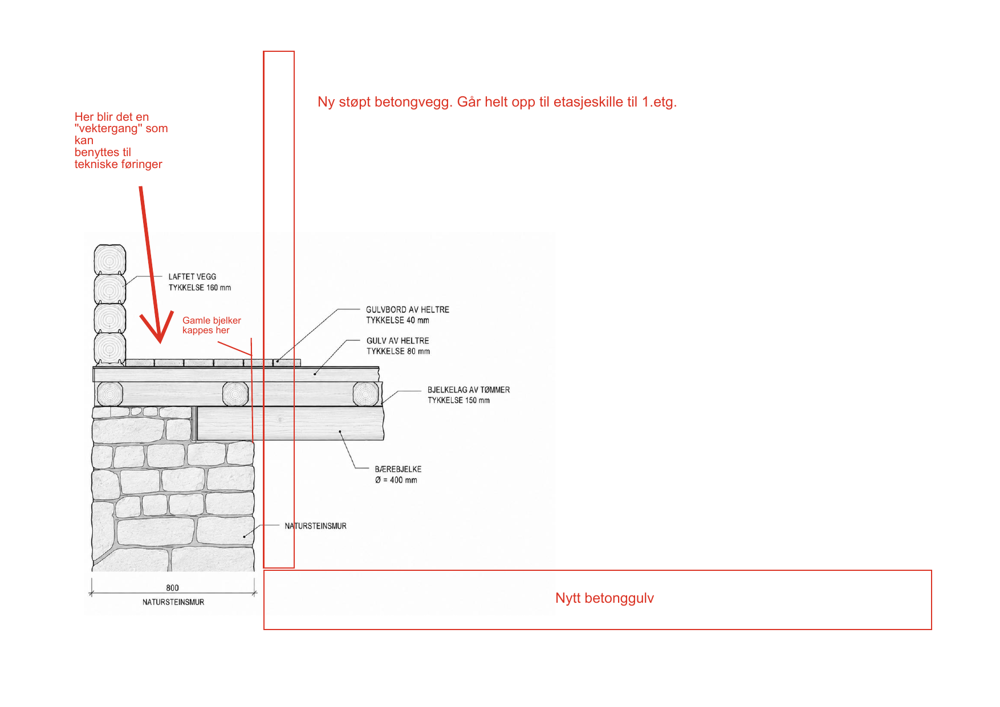

# Kjeller — løsning mot yttervegg

Tegning som viser snitt gjennom ny kjellervegg mot eksisterende yttervegg (brygge-vegg). Grensesnitt mellom nybygd betong og eksisterende trekonstruksjon.

## Annotasjoner fra tegningen

- **Ny støpt betongvegg** — går helt opp til etasjeskille mot 1. etg.
- **"Vektergang"** — rommet mellom ny betongvegg og eksisterende yttervegg kan benyttes til tekniske føringer.
- **Gamle bjelker** — kappes der ny betongvegg kommer inn.
- **Nytt betonggulv** — kjellergulv i vanntett betong.
