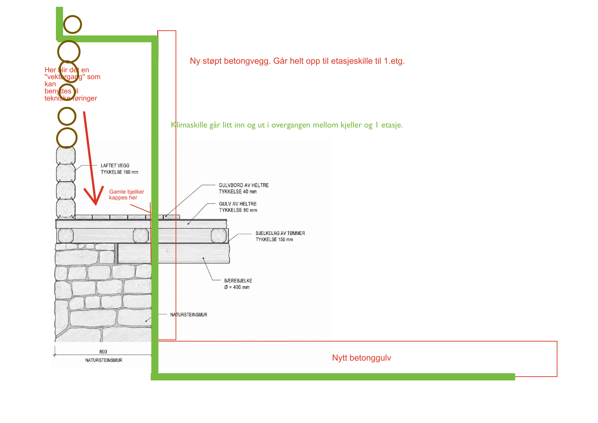

# Kjeller — løsning mot yttervegg med klimaskille

Variant av snittet mot yttervegg som også viser plassering av klimaskillet mellom kjeller og 1. etg.

## Annotasjoner fra tegningen

- **Ny støpt betongvegg** — går helt opp til etasjeskille mot 1. etg.
- **"Vektergang"** — rom for tekniske føringer mellom ny betongvegg og eksisterende yttervegg.
- **Klimaskille** — går litt inn og ut i overgangen mellom kjeller og 1. etasje.
- **Gamle bjelker** — kappes der ny betongvegg kommer inn.
- **Nytt betonggulv** — kjellergulv i vanntett betong.
