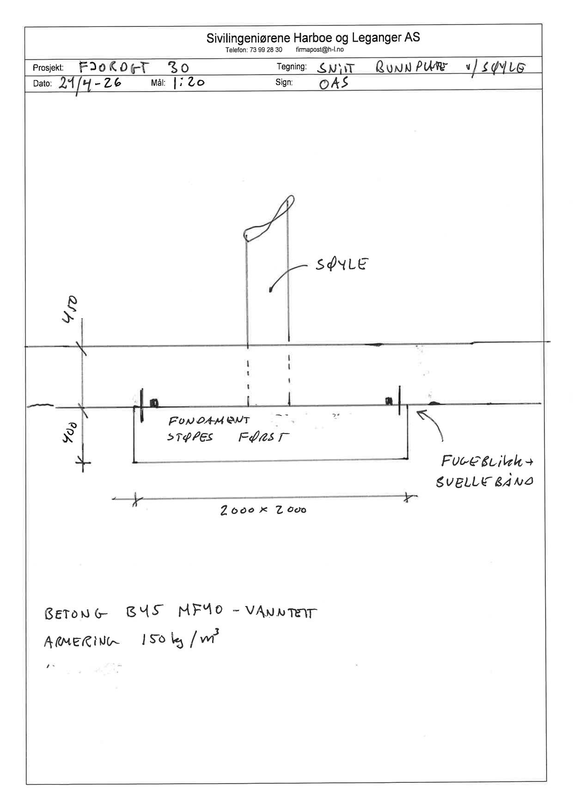
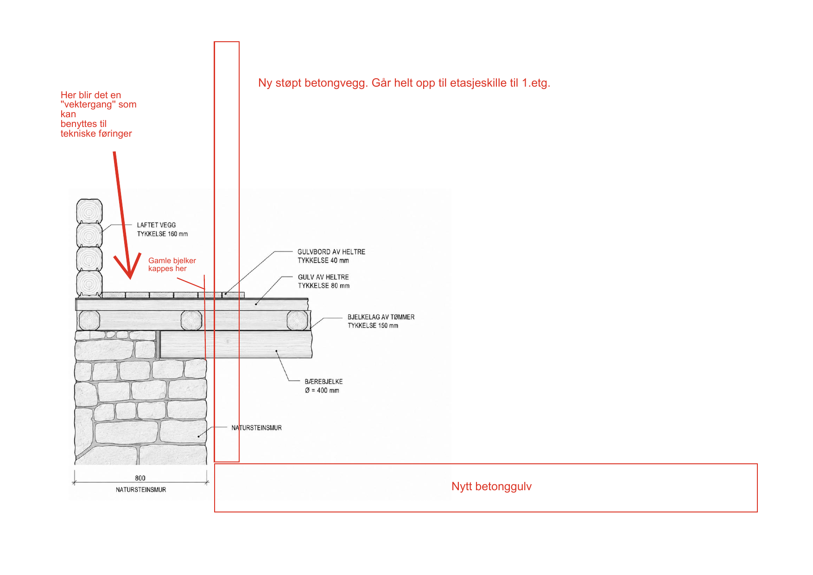
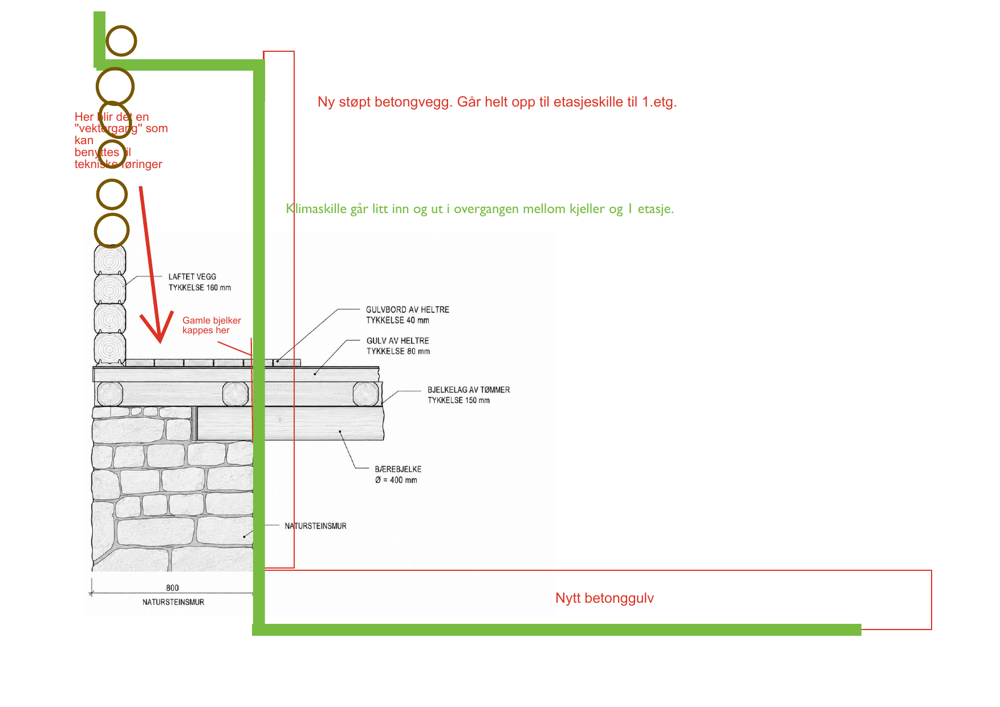
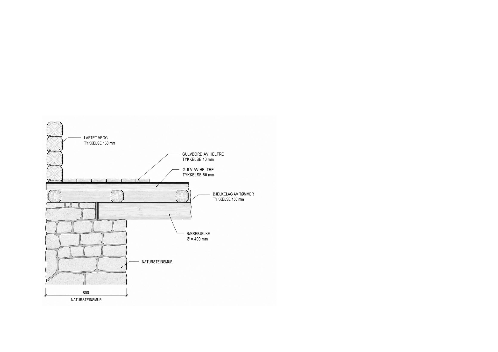

# Oversikt — kjellerdokumentasjon

Samling av tekniske grunnlagsdokumenter for kjellerarbeidet i Fjordgata 30. Hver `.md`-fil er en formattert avskrift av en PDF, med samme navn som pdfens undermappe for ekstraherte sider/figurer. Originalene ligger i `bakgrunn/nye/kjeller/` (ikke flyttet).

## 1. Innledning — status pr. 2026-10-21

Kjellerprosjektet står ved overgangen fra kartlegging og konseptfase til prosjektering og utførelse:

- **Konstruksjons- og lastgrunnlag er oppdatert for minilager.** RIB-notat av 10.02.2026 setter dimensjonerende nyttelast til 7,5 kN/m² i plan –1 og 1 og dimensjonerende vannstand til kote +3,20. Dette erstatter kontorlastene fra 2025.
- **Hovedprinsippet er ny vanntett kjeller inne i eksisterende natursteinsmur:** ny betongbunnplate på drenslag + XPS, nye betongvegger (ensidig forskaling nede mot natursteinsmur, tosidig oppover), nye søylefundamenter, katodisk korrosjonsbeskyttelse som offeranodeanlegg i gulv og vegger.
- **Oppdagelse fra sommer/høst 2026:** Da gulvbord og masser ble ryddet, viste det seg at det opprinnelige bolverk/kavlegulv fortsatt lå under gulvet bak natursteinsmuren, nedpakket i jord/grus med tildels alvorlige råte- og brannskader (notat 15.08.2026, Ole Morten/HRP). De tverrgående rundtømrene er stort sett borte; det som gjenstår er langsgående stokker. Byggets vertikallaster bæres i dag av det nye rammeverket i 1. og 2. etasje — ikke lenger av det gamle kavlegulvet.
- **Anbudsbeskrivelse foreligger som utkast:** ISY-beskrivelsen fra HRP av 19.10.2026 er en NS 3420-postliste for grunnarbeider, betongarbeider og katodisk korrosjonsbeskyttelse. Dokumentet er markert utkast med flere alternative tekstforslag og tomme felt — mengder og materialkrav er likevel reelle forpliktelser i teksten.
- **Åpne gatinger før kutting av bjelker:** Langsgående tømmerstokker som potensielt bærer skal RIB-signeres (Ole Stenmo, Harboe & Leganger) før de kappes. Dette er dokumentert i statusmøtet 20.10.2026.
- **Åpne gatinger før graving:** Riksantikvaren og Byantikvaren er inne i saken. Mye av grunnarbeidet i ISY-beskrivelsen er merket «mengde kan først bestemmes når godkjennelse for tiltakene foreligger».
- **Posisjoner på søyler innerst mot Fjordgata mangler i laserscanning.** Ole Morten måler opp selv onsdag 21.10.2026 med lasermåler fra kjent referansepunkt (toleranse 10 cm). Innerste søylerad mot Fjordgata er stål; de øvrige varierer.

Innholdsfortegnelse med klikkbare lenker til slutt i dokumentet.

---

## 2. Dokumenter — kronologisk

### 2.1 [2024-04-26_skisser_hl.md](2024-04-26_skisser_hl.md)

- **Type:** Tidlige konstruksjons-skisser, 4 sider, ingen tekst (bildetegninger).
- **Avsender:** Harboe og Leganger AS (RIB).
- **Innhold:** Tegningsserien som ligger til grunn for første vurdering fra RIB. Ren tegning uten tekstlag — innholdet ligger i selve bildene (sidene 1–4).
- **Dekker ikke:** Last- og bæreberegninger (kommer i 2025-06-13-notatet). Grensesnitt mot ny kjeller/minilagerkonsept (konseptet var fortsatt kontor på dette tidspunktet).

### 2.2 [2025-05-27_tegninger_beregninger_hl.md](2025-05-27_tegninger_beregninger_hl.md)

- **Type:** Tegningsvedlegg til beregningsnotatet 13.06.2025. 5 sider, ingen tekst.
- **Avsender:** Harboe og Leganger AS (RIB).
- **Innhold:** Oversikts- og detaljtegninger som underlag for lastkontrollene i 2025-06-13-notatet. Ingen tekstlag.
- **Dekker ikke:** Beregninger og konklusjoner (ligger i tilhørende notat).

### 2.3 [2025-06-13_notat_fjordgata30.md](2025-06-13_notat_fjordgata30.md)

- **Type:** RIB-notat, 12 sider.
- **Avsender:** Harboe og Leganger AS, Ole Stenmo. **Mottaker:** KodeWorks Eiendom AS.
- **Lastforutsetninger (gjelder kontor-scenariet):** egenvekt tak 0,8 kN/m², etasjeskiller inkl. lettvegger 1,5 kN/m², snølast 2,8 kN/m², **nyttelast kontor 3,0 kN/m²**.
- **Materialer:** heltre C18, limtre GL30c, stål S355. Brannkrav R60 på hovedbæring iht. Rambølls brannkonsept (merk: 2026-02-10-notatet henviser til HRP som brannrådgiver, så dette er senere skiftet ut).
- **Jordparametre:** sand (naturlig bløt), friksjonsvinkel 33°, egenvekt 17 kN/m³, forutsatt min. 150 mm oppfylling rundt fundament. Må verifiseres av geotekniker.
- **Fundamenter er delvis synlige mot elva, resten skjult.** Fundamentene ligger på terrengnivå (ikke nedgravd), er delvis undervasket, og flere betong- og tresøyler står eksentrisk på bankettene.
- **Grunntrykkskontroller:** maks grunntrykk under banketter 104 kN/m² sentrisk belastet (OK), men skjevbelastede fundamenter akse C/D gir 258 kN/m² mot bæreevne 101 kN/m² (ikke OK). Utvides minimum 0,4 m og forankres med innboret armering. Søylefundament akse B utvides 150 mm; nye fundamenter under tregulv mot Fjordgata skal være 2,1 × 2,1 m sentrisk under søyle.
- **Plan 0 (under bryggen):** flere tresøyler har store råteskader og må skiftes ut.
- **Plan 1–4:** stålkonstruksjon på plan 1 OK (HEA 280 + HUP 150×150×5); limtre på plan 0/1 underdimensjonert; rundåser må ha minimum ø220 for spv. 2,7 m og ø250 for 3,2 m for R60; heltresøyler må være ca. ø250 i plan 1–2 og ø220 i plan 3–4 for R60.
- **Tak:** 60×130 cc 800–900 på 150×200 bjelker — underdimensjonert, anbefales bygd på nytt.
- **Stabilitet/skjevstilling:** store helningsavvik i tverretning, ufullstendig system for vindlaster, store åpninger i gavlvegger. Anbefales stålavstiving i akse 4 og 6+ i forbindelse med lyssjakt.
- **Dekker ikke:** kjellerspesifikke tiltak (bunnplate, vanntetting, vanntrykk) — det kommer i februar 2026-notatet som er en overbygning av dette.

### 2.4 [2026-02-10_notat_rib.md](2026-02-10_notat_rib.md)

- **Type:** Oppdatert RIB-notat for ombygging til minilager (ikke lenger kontor). 7 sider.
- **Avsender:** Harboe og Leganger AS, Ole Stenmo. **Mottaker:** KodeWorks Eiendom AS. Henviser eksplisitt til 13.06.2025-notatet for grunnprinsipper.
- **Nye lastforutsetninger:** egenvekt tak 0,8 kN/m², etasjeskiller 1,5 kN/m², snølast 2,8 kN/m²; nyttelast etter NS EN 1991: **7,5 kN/m² for plan –1 og 1**, 5,0 kN/m² i boder og 3,0 kN/m² i adkomstarealer plan 2–5 (på grunn av lav takhøyde). Minilager gir ca. 50 % mer last enn kontor.
- **Brannkrav:** R60 på hovedbæring og sekundærbæring iht. brannkonsept fra HRP (merk: byttet fra Rambøll).
- **Fundamentering:** samme prinsipp som i 2025-notatet, men i større omfang. Eksakte dimensjoner defineres i detaljprosjektering.
- **Ny kjeller:** «En større andel av eksisterende fundamenter skiftes ut med ny bunnplate.» Bunnplate i **vanntett betong**, beregnet for byggets laster + vanntrykk. Kjellervegger skal utføres vanntett.
- **Dimensjonerende vannstand:** kote **+3,20**.
- **Plan 1–4 oppdatert:** stålkonstruksjon på plan 1 i prinsippet OK, men må sjekkes nærmere ift. søylelaster på bjelkene. Rundåser: kun ø220 for 2,7 m spv. har nok styrke, og **ingen** oppfyller brannkrav uten tiltak — mye nytt bjelkelag må inn, hele etasjeskillet brannbeskyttes. Hovedbjelker og heltresøyler må forsterkes og brannbeskyttes.
- **Avstiving:** etableres i forbindelse med nye heis- og trappesjakter (erstatter stålkryss-konseptet fra 2025).
- **Dekker ikke:** detaljprosjektering av fundamenter og vegger (henviser dette til detaljfase). Søyleantall, materialer og eksakte posisjoner i kjeller er ikke listet.

### 2.5 [2026-08-15_notat_baeresystem_kjellergulv.md](../2026-08-15_notat_baeresystem_kjellergulv.md)

*Fysisk plassering: `bakgrunn/`, ikke `bakgrunn/kjeller/`. Likevel sentralt for kjellerforståelsen.*

- **Type:** Fagnotat om oppdagelse av gjenværende bolverk/kavlegulv under eksisterende kjellergulv.
- **Avsender:** Ole Morten Lagmannssveen, HRP AS (PGL/antikvarisk istandsetting).
- **Oppdagelse:** Da gulvplank ble demontert, viste det seg at kavlegulv og bolverk fortsatt lå som bærende konstruksjon under gulvbordene bak natursteinsmuren — i motsetning til hva som ble antatt etter 1983-ombyggingen.
- **Konstruksjonsbeskrivelse:** Grove rundtømmer opp til 16″ spenner i byggets bredde, opplagret på natursteinsmur, med 2,5–3 m avstand. Mindre rundtømmer i lengderetningen cc 1–1,5 m, med kavlegulv (tettliggende tømmer) oppå på tvers.
- **Materialkvalitet:** gjenbrukstømmer med spor av lafteknuter, meddrag og tappehull.
- **Opplagring:** innerst ligger bolverket nedpakket i jord/grus; ytterst mot kanalen står tømmeret på natursteinsfundament, og den ytterste bjelken har tømmer-opplagringsbukk.
- **Skader:** Betydelige råte- og brannskader særlig i det treverket som har ligget nedpakket, i opplagringsbukken, og i kavlegulv ved yttervegg (fukteksponert).
- **Nye fundamenter (1983) er delvis ugunstig plassert** — støpt oppå eldre fundamenter og natursteinsmur, flere uten ordentlig forskaling.
- **Masse-observasjon:** Jordmassene bak natursteinsmuren er omrørt flere ganger med etterlatenskaper (kopper, blikkbokser, stål-/plastrør, søppel). Omrørte masser = færre antikvariske restriksjoner enn uomrørte masser.
- **Redaktørkommentar i originalen:** «Trigger mtp. riksantikvar?» — ved fjerning av bolverket.
- **Dekker ikke:** forslag til ny bæring. Dokumentet er beskrivende, ikke prosjekterende. Ingen tallfestede dimensjoner eller sten-/stokk-tegninger.

### 2.6 [2026-08-28_kjeller_losning_mot_yttervegg.md](2026-08-28_kjeller_losning_mot_yttervegg.md)

- **Type:** Snittegning, 1 side.
- **Innhold (annotasjoner):** Ny støpt betongvegg som går opp til etasjeskille mot 1. etg. «Vektergang» mellom ny betongvegg og eksisterende yttervegg brukes til tekniske føringer. Gamle bjelker kappes der ny betongvegg kommer inn. Nytt betonggulv i vanntett betong.
- **Dekker ikke:** klimaskillet (det er egen variant, 2.7). Mål, armeringsklasser, tetting mellom bunnplate/vegg.

### 2.7 [2026-08-28_kjeller_losning_mot_yttervegg_klimaskille.md](2026-08-28_kjeller_losning_mot_yttervegg_klimaskille.md)

- **Type:** Variant av 2.6, 1 side, nå med klimaskille eksplisitt inntegnet.
- **Innhold (annotasjoner):** Som 2.6, pluss: klimaskillet går «litt inn og ut» i overgangen mellom kjeller og 1. etasje.
- **Dekker ikke:** om klimaskillet ligger over eller under bjelkelaget, isolasjonstykkelse, lufttetthetsdetaljer.

### 2.8 [2026-08-28_snitt_vegg_gulv_fg30.md](2026-08-28_snitt_vegg_gulv_fg30.md)

- **Type:** Snittegning av ny vegg og gulv, 1 side. Ingen tekstlag — innholdet ligger i bildet.
- **Dekker ikke:** tekstlige kommentarer eller mengder.

### 2.9 [2026-10-19_fg30_beskrivelse_kjeller.md](2026-10-19_fg30_beskrivelse_kjeller.md)

- **Type:** ISY-beskrivelse etter NS 3420 (4. utgave), 28 sider.
- **Avsender:** HRP AS. **Mottaker:** KodeWorks Eiendom AS.
- **Status i PDF-en:** Utkast med alternative tekstforslag og tomme felt (dato, antall, adresse). Inneholder også HRPs egne arbeidsnotater («bearbeid derfor selv innholdet og fjern det du ikke trenger!»). Innholdet er beholdt verbatim i .md-filen.
- **Innhold — reelle forpliktelser (ikke mal-utkast):**
  - **Hovedprinsipp:** «Betongarbeider i kjeller må påregnes delvis under vannspeil — både graving, gjenfylling, forskaling og støping.» Ekstrakostnader skal medtas i alle prisbærende poster.
  - **Kapittel 03 Grunnarbeider:** graving ned til samme nivå som innvendig veggliv på eksisterende natursteinsmur, 130 m³ fast volum, opplasting i containere på gateplan (Fjordgata). I tillegg graving under vann (vanndybde 0–1 m, 10 m³) på utside av natursteinsmur mot kanalen for forsterkning av eksisterende fundamenter. Mengder er regulerbare — avhenger av arkeologisk klarering.
  - **Grunnforhold i kjeller:** fylte løsmasser, grus med mindre steiner, kan komme i konflikt med vannstand i kanalen. Mulighet for kulturlag — prøvegraving kreves.
  - **Grunnforhold utside mur:** sand- og grusavsetninger fra elven. Omsøkes i flere instanser før gravearbeid.
  - **Drenslag:** 16/32 sortering, inntil 200 mm, 30 m² (eksterne masser).
  - **Forsterkningslag:** sand/grus 0/4, inntil 100 mm, 15 m².
  - **Isolering under gulv:** XPS 50 mm, 350 m².
  - **Isolering mellom natursteinsmur og ny plate / vegg (kantisolasjon):** XPS 50 mm, både som varmeisolering og som glidesjikt slik at ny betong ikke støpes sammen med natursteinsmuren.
  - **Isolering under punktfundamenter:** XPS 50 mm, 25 stk (fundamentdimensjon 3000 × 3000 mm iht. post 05.29 — men merk motsetning mot 05.1, se §6).
  - **Bunnplate (post 05.14):** 450 mm tykkelse, armert, vanntett. Fasthetsklasse B45, bestandighetsklasse MF40, kloridklasse Cl 0,10, utførelsesklasse 2. 115 m³. Toleranse klasse PB.
  - **Yttervegger — ensidig forskaling nede mot natursteinsmur (post 05.2):** 110 m², gjennomsnittlig tykkelse 30 cm, høyde ca. 1,7 m, plast/duk mot natursteinsmuren for å unngå sammenstøyping. Gjelder alle 4 yttervegger.
  - **Yttervegger — tosidig forskaling oppover (post 05.3):** 95 m², tykkelse 250 mm, fortsettelse av ensidig forskaling fra topp av natursteinsmur og opp til bjelkelag mot 1. etg.
  - **Yttervegger — vanntett betong (post 05.16):** B45, MF40, Cl 0,10, 52 m³. Natursteinsmuren fungerer som den ene siden av forskalingen i nedre del.
  - **Delevegger (post 05.9):** betong C25/30, konsistensklasse S3, eksponeringsklasse XC1 (innvendig tørt miljø), armering B500NC, utførelsesklasse 2, tykkelse 250 mm. Postnavnet er «FORSKALING AV VEGG, delevegger til bæring».
  - **Delevegger med tunge tilslag (post 05.17):** B45, M40, Cl 1,0, utførelsesklasse 2, lengderetning. Mengde regulerbar.
  - **Fundamenter i søndre del av kjeller (post 05.15):** AUV-betong B45, MF40, Cl 0,10, utførelsesklasse 3, 40 m³, 400 mm tykkelse. Tidevann/stormflo.
  - **Nye søylefundamenter (post 05.1):** 25 stk, minimumsmål **200 × 200 cm, 40 cm tykkelse**, overkant tangerer underkant av nytt dekke (dekkes av platestøpen). Søyler skal stå på samme sted som dagens søyler, men etableres dypere.
  - **Fundamenter ut mot Nidelva (post 05.18):** AUV-betong B45, MF40, Cl 0,10, utførelsesklasse 3. Reparasjon/supplering av eksisterende, tilpasset tidevannsrytme.
  - **Fundamentforsterkning i vann (post 05.25):** Fjerning, enkeltstående ensidige forskalinger H=500, L=1000, B=1000 mm på flere eksisterende fundamenter ut mot Nidelva.
  - **Armering (postene 05.9/05.11/05.14 med flere):** B500NC, utførelsesklasse 2 eller 3, overdekning iht. krav for **XS3** (bunnplate, fundamenter under grunnvann, yttervegger, delevegger). Angitt 150 kg/m³ for bunnplate og fundamenter under grunnvann; ø16 mm for delevegger og yttervegger.
  - **Vanntetting:** Svelleprofil av polymerer (SikaSwell® P type H eller tilsvarende) i alle støpeskjøter dekke/vegg, 65 m. Beskyttelse mot utvasking med fugeblikk (Master VB2 160 eller tilsvarende), 65 m. Svelletetting rundt søylegjennomføringer: hydrofilt polymerbasert svellebånd (SikaSwell® P Ring 24 NO) for 25 stk ø150–200 mm stålsøyler. Bruksmiljø saltvann.
  - **Radonsperre (post 05.19):** plastbasert belegg, bruksgruppe A2, teiping av skjøter, under ny plate innenfor natursteinsmur. Må være kombinert radon- og fuktsperre. (Jf. §6 — statusmøte 22.10 har besluttet å søke dispensasjon likevel.)
  - **Overflatebearbeiding:** stålglatting av gulv, glatt flate etter forskalingsplater for vegger, syrevasking av innvendige vegger (295 m²).
  - **Kapittel 40 Elkraft (post 40.2):** rigging for katodisk korrosjonsbeskyttelse som offeranodeanlegg, lokalisering kjeller gulv og vegger, overordnet miljø marint. (Rund sum, areal støttekonstruksjon tomt.)
- **Henvisninger (navngitte):** Byggforsk-blad 520.055 for vanntette konstruksjoner under grunnvann, NS-EN 1992/1997/13670, NS-EN 206.
- **Dekker ikke / er mangelfylt:**
  - **Endelig antall søyler, materialer og eksakte posisjoner** (post 05.1 nevner «25 stk» i mengde, men søyleposisjoner mangler fordi laserscanning innerst mot Fjordgata er ufullstendig, se §5).
  - **Betongleverandør** er ikke valgt; alle poster står med materialspesifikasjon men ingen prekvalifisert leverandør.
  - **Tidsestimat per operasjon** finnes ikke i dokumentet.
  - **Fundamentdimensjon er inkonsistent:** post 05.1 sier 200 × 200 × 40 cm, post 05.29 (isolering under samme fundamenter) sier 3000 × 3000 mm. HRP-utkastet må avklares.
  - **Flere poster har mengde oppgitt som 0,00** (overflatebearbeiding av søyler og vegger, forskaling i vann uten mengde) — dvs. ikke prisbærende i utkastet.
  - **Rekkefølgen i NS 3420-nummereringen hopper** (05.4 → 05.6, 05.9 inneholder 05.10 i teksten osv.) — dette er beholdt verbatim.

---

## 3. Tematisk sammenstilling

### 3.1 Last og dimensjonering

| Dim.-grunnlag | 2025-06-13 (kontor) | 2026-02-10 (minilager, gjeldende) |
|---|---|---|
| Nyttelast plan –1 og 1 | 3,0 kN/m² | **7,5 kN/m²** |
| Nyttelast plan 2–5 | 3,0 kN/m² | 5,0 kN/m² i boder, 3,0 kN/m² i adkomst |
| Snølast tak | 2,8 kN/m² | 2,8 kN/m² |
| Egenvekt etasjeskiller | 1,5 kN/m² | 1,5 kN/m² |
| Egenvekt tak | 0,8 kN/m² | 0,8 kN/m² |
| Brannkrav hovedbæring | R60 (Rambøll) | R60 (HRP) |
| Dim. vannstand | ikke angitt | **kote +3,20** (ny bunnplate og kjellervegger må være vanntett) |

Minilager gir ca. **50 % mer last** enn kontor. Dette er den styrende endringen fra 2025 til 2026.

### 3.2 Fundamentering og bunnplate

- **Eksisterende fundamenter** mot elva er delvis undervasket og eksentrisk belastet (bankett akse C/D: 258 kN/m² mot bæreevne 101 kN/m², ikke OK). Må utvides minimum 0,4 m og innbores med armering (2025-06-13).
- **Punktfundament akse B** utvides 150 mm. Fundamenter under tregulv mot Fjordgata må være 2,1 × 2,1 m sentrisk under søyle (2025-06-13).
- **Ny bunnplate for kjeller:** 450 mm tykkelse, vanntett betong B45 / MF40 / Cl 0,10 / utførelsesklasse 2, 115 m³, armert B500NC 150 kg/m³, eksponeringsklasse XS3, toleranse klasse PB (2026-10-19 post 05.14). **Støypes som helhetlig plate** (ikke seksjonert med glidebolter) — besluttet av Ole Morten + RIB, statusmøte 22.10 Post 02.
- **Nye søylefundamenter i søndre del av kjeller:** 25 stk, 200 × 200 × 40 cm (merk motsetning mot 05.29 som sier 3000 × 3000 mm). Overkant tangerer underkant dekke (post 05.1). AUV-betong, 40 m³ totalt, utførelsesklasse 3 (post 05.15).
- **Reparasjon av eksisterende fundamenter ut mot Nidelva** gjøres tilpasset tidevann med AUV-betong (post 05.18) og ensidig forskaling i vann (post 05.25).
- **Bæresystem i kjellergulv (gammelt bolverk):** Deler bevares foreløpig for mulig forskningsprosjekt — tjukke tømmerstokker på tvers av bygget bevares, alt annet trevirke fjernes (statusmøte 25.10 Post 02).

### 3.3 Betongvegger

- **Mot naturstein (ensidig nedre del):** 110 m², ca. 30 cm snittykkelse, ca. 1,7 m høyde. Plast eller tett duk mot muren for å unngå sammenstøyping (post 05.2). Fylte 4 vegger.
- **Fra topp natursteinsmur og opp (tosidig):** 95 m², 250 mm tykkelse (post 05.3). Steng mellom bunn tosidig forskaling og topp natursteinsmur — 65 lm (post 05.4).
- **Vanntett yttervegg:** B45, MF40, Cl 0,10, 52 m³, XS3 (post 05.16). Natursteinsmur fungerer som ene siden av forskalingen i nedre del.
- **Delevegger til bæring:** 250 mm, B500NC armering, XC1 (**innvendig tørt miljø** — merk at dette er lavere eksponeringsklasse enn ytterveggene).
- **Delevegger med tunge tilslag (lengderetning):** B45, M40, Cl 1,0 (post 05.17) — avviker fra andre delevegger. Mengde regulerbar.
- **Snitt-prinsipp mot yttervegg:** ny betongvegg går helt opp til etasjeskille mot 1. etg; «vektergang» mellom ny betongvegg og eksisterende yttervegg for tekniske føringer (2026-08-28, begge varianter).
- **Klimaskille:** går «litt inn og ut» i overgangen mellom kjeller og 1. etasje (2026-08-28 klimaskille-variant).

### 3.4 Søyler

- **Antall:** post 05.1 i ISY-beskrivelsen oppgir **25 nye søylefundamenter i søndre del av kjeller**. Post 05.8 oppgir **25 stk ø150–200 mm stålsøylegjennomføringer** med svellebånd — altså tilsvarende antall.
- **Materiale innerst mot Fjordgata:** **stål**. Dette er bekreftet i statusmøte 20.10 Post 04. De øvrige søylene varierer i materiale.
- **Posisjoner innerst mot Fjordgata mangler** i laserscanning fordi scanning ikke var tilgjengelig på det tidspunktet. **Måles opp 21.10.2026** av Ole Morten med lasermåler fra kjent referansepunkt, toleranse 10 cm. Hver søyle annoteres med materiale og type (statusmøte 20.10 Post 04).
- **Søyler i søndre del:** skal stå på samme sted som i dag, men etableres dypere (post 05.1).
- **Svelleprofil rundt søylegjennomføringer:** SikaSwell® P Ring 24 NO eller tilsvarende, dokumentert for saltvann (post 05.8). Søyle står på fundament under nytt 450 mm dekke.

### 3.5 Tømmerstokker og bæring

- **Tverrgående rundtømmer** (grove, opp til 16″, cc 2,5–3 m, byggets bredde): i det alt vesentlige **borte**. De som gjenstår er i hovedsak langsgående (statusmøte 20.10 Post 05 og 22.10 Post 01.02).
- **Byggets vertikallast bæres i dag av det nye rammeverket i 1. og 2. etg., ikke lenger av kavlegulvet/bolverket** (statusmøte 22.10 Post 01.02).
- **Status for kutting:** Lavrisk arbeid (fjerning av råttent/brannskadet trevirke over natursteinsmurens overkant) kan fortsette uten RIB-godkjenning (statusmøte 22.10 Post 01). Tverrgående bærende bjelker krever **RIB-signert sikringsplan** (Ole Stenmo, Harboe & Leganger) **før** arbeid igangsettes — absolutt krav fra byggherre. Langsgående stokker krever også RIB-gating før kutting hvis de har potensielt bærende funksjon.
- **Beslutning 25.10:** Tjukke tømmerstokker på tvers bevares (for mulig forskningsprosjekt); alt annet trevirke fjernes. Ole Morten tar formell avsjekk mot RIB før kjellerarbeid utenfor «grønt-sone» starter.
- **Gjenbruksplan:** Kutting i prefabrikkerte lengder for gjenbruk mot kanalen (ca. 2–2,5 m, 2–300 kg per stokk) — droppes gjennom gulvåpning til flo for transport og remonteres (statusmøte 20.10 Post 05).

### 3.6 Vanntetting og katodisk korrosjonsbeskyttelse

- **Vanntetting i støpeskjøter:** svelleprofil av polymerer (SikaSwell® P type H eller tilsvarende), 65 m i alle overganger dekke/vegg. Beskyttelse mot utvasking: tetteplate (fugeblikk) med dobbelsidig forsterket polymer, 65 m (Master VB2 160 eller tilsvarende). Bruksmiljø saltvann.
- **Vanntetting rundt søylegjennomføringer:** hydrofilt polymerbasert svellebånd dokumentert for maritime miljøer, 25 stk, ø150–200 mm (post 05.8).
- **Prosjekteringsgrunnlag:** Byggforsk-blad **520.055** for vanntette konstruksjoner under grunnvann. NS-EN 1992/1997/13670, materialstandard NS-EN 206, utførelsesspesifikasjon iht. NS-EN 13670.
- **Katodisk korrosjonsbeskyttelse:** offeranodeanlegg i kjellergulv og vegger, overordnet miljø marint (post 40.2). Som rund sum, areal støttekonstruksjon ikke utfylt i utkastet.
- **Radonsperre:** post 05.19 beskriver plastbasert belegg, bruksgruppe A2, teiping av skjøter, kombinert radon- og fuktsperre. **Statusmøte 22.10 Post 03:** søkes dispensasjon fra kravet med henvisning til at Trondheim ligger på elvegrus, ikke på radon-utsatt fjell. Radonsperre tegnes likevel inn som fallback.

### 3.7 Takhøyde og graving

- **Målsetting:** 3 m takhøyde i kjeller (statusmøte 20.10 Post 12, under «etter avklaring fra arkeolog»).
- **Graving:** 130 m³ fast volum innenfor natursteinsmur, graveskråning: rett ned til samme nivå som innvendig veggliv på muren. Opplasting i containere på gateplan Fjordgata (post 03.1/03.2). Transportlengde 6–9 km (post 03.5).
- **Graverestriksjoner:** mulighet for kulturlag, prøvegraving kreves. Avklaringer med Riksantikvaren og Byantikvaren står åpne. Riksantikvarens betingelse er at det ikke graves i uomrørte masser — kun i allerede omrørte (statusmøte 22.10 Post 04).
- **Graving under vann:** 10 m³, 0–1 m vanndybde, utside av natursteinsmur mot kanalen, graveskråning 1:3, for forsterkning av eksisterende fundamenter. Omsøkes i flere instanser før oppstart.
- **Totale masser til deponi:** 200 tonn blandede masser (grus/sand/stein) etter grunnarbeidene.

### 3.8 Rekkefølge og avhengigheter

Prioritet pr. 2026-10-21 (statusmøte 20.10 og 22.10):

1. **Flytte toalett + minikjøkken til 1. etg** og bygge ny kjellernedgang (frostfrihet og tilkomst — forutsetning for intensivert kjellerarbeid).
2. **Måle opp søyleposisjoner innerst mot Fjordgata** (Ole Morten 21.10).
3. **Lavrisk fjerning av råttent/brannskadet trevirke over natursteinsmurens overkant** — kan starte 26.10 (Ain + Marco) uten RIB-godkjenning.
4. **Felles befaring Ole Morten + Kristian** når Kristian er tilbake fra reise, for å definere trygt fjerningsomfang.
5. **Ole Mortens kjellernotat med sikringsplan** ferdigstilles helg/mandag 25.–26.10.
6. **RIB (Ole Stenmo) signerer sikringsplan** → gating for kutting av tverrgående bjelker.
7. **Avklaring fra arkeolog/Riksantikvar** → gating for graving: kutting av rundtømmer i prefabrikkerte lengder, flytting av stein i kjeller for stabilisering av tørrmuren, fjerning av siste del av kjellergulv mot gateplan, utgraving til 3 m takhøyde.
8. **Igangsettingstillatelse (IG)** for betongarbeid er egen sak — fjerning av gammelt trevirke regnes som vedlikehold og krever ikke særskilt tillatelse, men å støpe nytt betonggulv krever IG (statusmøte 22.10 Post 04.03).

---

## 4. Konkrete tall og materialvalg (NS 3420-utdrag)

Tabellen samler det som er numerisk forpliktet i dokumentene. Mengder er fra ISY-beskrivelsen 19.10.2026 og er merket regulerbare der dokumentet sier det.

| Del | Verdi | Kilde |
|---|---|---|
| Nyttelast plan –1 og 1 | 7,5 kN/m² | 2026-02-10 RIB-notat |
| Nyttelast plan 2–5 (boder / adkomst) | 5,0 / 3,0 kN/m² | 2026-02-10 |
| Dim. vannstand | kote +3,20 | 2026-02-10 |
| Brannkrav bæring | R60 | 2026-02-10 |
| Graving generelle nivåer, kjeller | 130 m³ (fast volum, regulerbar) | 03.1 |
| Graving under vann (utside mur) | 10 m³, 0–1 m vanndybde, 1:3 skråning | 03.3 |
| Drenslag 16/32 | 30 m², inntil 200 mm | 03.7 |
| Forsterkningslag 0/4 | 15 m², inntil 100 mm | 03.8 |
| Masser til deponi | 200 tonn | 03.6 |
| Isolering under gulv (XPS) | 50 mm, 350 m² | 03.10 |
| Isolering mot natursteinsmur (XPS) | 50 mm, kantisolasjon, som glidesjikt | 05.27/05.28 |
| Isolering under punktfundament (XPS) | 50 mm, 25 stk, fundament 3000 × 3000 mm (**motsetning mot 05.1**) | 05.29 |
| Bunnplate | 450 mm, 115 m³, B45, MF40, Cl 0,10, utførelsesklasse 2, PB-toleranse | 05.14 |
| Fundamenter søndre del kjeller | 400 mm, 40 m³, AUV-betong B45, MF40, Cl 0,10, utførelsesklasse 3 | 05.15 |
| Nye søylefundamenter | 25 stk, min. 200 × 200 × 40 cm | 05.1 |
| Yttervegg ensidig forskaling (nede) | 110 m², snitt 30 cm tykkelse, 1,7 m høyde | 05.2 |
| Yttervegg tosidig forskaling (oppe) | 95 m², 250 mm tykkelse | 05.3 |
| Yttervegg vanntett betong | 52 m³, B45, MF40, Cl 0,10 | 05.16 |
| Delevegg | 250 mm, C25/30, S3, XC1, B500NC, utførelsesklasse 2 | 05.9 |
| Delevegg med tunge tilslag (lengderetning) | B45, M40, Cl 1,0, 9 + 20 m³ regulerbar | 05.17 |
| Steng mellom en- og tosidig forskaling | 65 lm | 05.4 |
| Armering bunnplate + fundamenter under grunnvann | B500NC, 150 kg/m³, utførelsesklasse 3, XS3 | 05.11 |
| Armering delevegg + yttervegger | B500NC, ø16 mm, utførelsesklasse 3, XS3 | 05.11 |
| Svelleprofil polymer dekke/vegg (SikaSwell P type H el. tilsv.) | 65 m, saltvann | 05.6 |
| Fugeblikk (Master VB2 160 el. tilsv.) | 65 m | 05.7 |
| Svellebånd rundt søyle (SikaSwell P Ring 24 NO el. tilsv.) | 25 stk, ø150–200 mm stål | 05.8 |
| Radonsperre | plastbasert, bruksgruppe A2, kombinert radon+fukt | 05.19 (søkes dispensasjon) |
| Syrevasking vegger | 295 m² | 05.26 |
| Katodisk korrosjonsbeskyttelse | offeranodeanlegg, marint miljø, kjeller gulv + vegger (rund sum) | 40.2 |

**Standarder navngitt:** NS 3420 4. utgave, NS-EN 206 (materialstandard), NS-EN 1992 (prosjektering), NS-EN 1997 (geoteknikk), NS-EN 13670 (utførelse betong). Byggforsk-blad 520.055 (vanntette konstruksjoner under grunnvann).

---

## 5. Åpne spørsmål og hull

**Prioritet pr. 2026-10-21:**

1. **Søyleposisjoner innerst mot Fjordgata mangler.** Laserscanning dekker ikke området godt nok. Måles opp av Ole Morten med lasermåler onsdag 21.10 (statusmøte 20.10 Post 04). Toleranse 10 cm. Innerste søylerad er stål; de øvrige varierer — materiale og type må annoteres per søyle.
2. **Betongleverandør er ikke valgt.** ISY-beskrivelsen 19.10.2026 spesifiserer materialklasser (B45, MF40, Cl 0,10, C25/30, AUV-betong B45) men ikke leverandør. Flere betongtyper trengs: standard C25/30 (deleveggene), B45 vanntett (bunnplate + yttervegger), AUV-betong B45 (fundamenter under vann). Må kvalifiseres mot leveringssted og tidevann.
3. **Tidsestimat per operasjon mangler.** Ingen av dokumentene i mappen oppgir timetall eller varighet per NS 3420-post. ISY-beskrivelsen er priss- og mengdebeskrivelse, ikke framdriftsplan.
4. **Rekkefølge-detaljer mangler** for de operasjonelle oppgavene: Hva fjernes når, hvor legges stein, hvilke jordhauger skal fjernes først, hvor plasseres mellomlager mens graving pågår, hvordan koordineres kutting av stokker med dropp til flo for gjenbruk. Statusmøte 20.10 Post 12 beskriver prioritert liste på høyt nivå, men ikke per-dag/per-uke-plan.
5. **Lokaliseringskart for aktuell kjellertilstand mangler.** Hvor er det fortsatt gulvplanker intakt, hvor er løse stein, hvor er løsmasser, hvor er omrørte vs. uomrørte masser — dette er sentralt for Riksantikvarens krav. Finnes beskrivelse i tekst (notat 15.08.2026) men ikke som annotert plankart.
6. **Bjelkekutting-status.** Hvilke bjelker er allerede kappet (jf. notat 15.08.2026 om 1983-ombyggingen), hvilke står igjen (hovedsakelig langsgående), og hvilke må RIB-signeres før kutting — er dokumentert kvalitativt, men ikke som annotert liste per bjelke-ID.
7. **Fundamentdimensjon-inkonsistens:** Post 05.1 sier 200 × 200 × 40 cm minimum, mens post 05.29 (isolering) sier 3000 × 3000 mm. Må avklares med HRP.
8. **Dimensjonerende vindlast/skjevstilling** er behandlet i 2025-06-13-notatet (lyssjakt + stålkryss), men 2026-02-10-notatet erstatter dette med «avstiving i forbindelse med nye heis- og trappesjakter» uten tallfesting. Må detaljeres i detaljprosjektering.
9. **Flere ISY-poster står med mengde 0,00** (overflatebearbeiding søyle, overflatebearbeiding vegg uten lokalisering osv.) — enten pris disse eller fjern dem fra prisgrunnlaget før anbudsutsendelse.
10. **Klimaskille-detaljer:** Snittet 28.08.2026 viser at klimaskillet går «litt inn og ut», men isolasjonstykkelse, lufttetthetsdetaljer, dampsperreplass og U-verdikrav mangler i kjeller-mappen.

---

## 6. Krysskoblinger og motsetninger

- **Last:** 2026-02-10 overstyrer 2025-06-13 på nyttelast. Alle framtidige fundamentberegninger skal bruke 7,5 / 5,0 / 3,0 kN/m², ikke 3,0 kN/m².
- **Brannkonsept:** Rambøll (2025-06-13) → HRP (2026-02-10). HRP er aktuell brannrådgiver via Gunnhild (statusmøte 22.10 Post 06).
- **Avstiving:** stålkryss ved lyssjakt (2025-06-13) → avstiving via heis- og trappesjakter (2026-02-10).
- **Fundamentdimensjon post 05.1 vs. 05.29:** 200 × 200 × 40 cm vs. 3000 × 3000 mm. HRP-utkast må avklares.
- **Bunnplate-støyping:** ISY-beskrivelsen beskriver platen som vanntett med svelleprofil og fugeblikk i støpeskjøter — forenlig med både seksjonert og helhetlig plate. Statusmøte 22.10 Post 02 konkluderer med **helhetlig plate** (uten glidebolter). Betongtypen tilpasses helhetlig støyping. Dette må oppdateres i kjellernotatet.
- **Radonsperre:** post 05.19 krever den; statusmøte 22.10 Post 03 vedtar at det søkes dispensasjon med begrunnelse i grunnforhold. Radonsperre tegnes likevel inn som fallback.
- **Bæresystem i kjellergulv:** Opprinnelig antakelse etter 1983-ombyggingen var at bolverk/kavlegulv var fjernet (notat 15.08.2026, første avsnitt). Faktisk var det bevart under gulvbordene. Fra oktober 2026 er praktisk konklusjon at bygget uansett ikke lenger står på kavlegulvet, men på det nye rammeverket i 1. og 2. etg (statusmøte 22.10 Post 01.02). Tjukke tverrgående tømmerstokker bevares for forskning, ikke for bæring (statusmøte 25.10 Post 02).
- **Eksponeringsklasse yttervegg vs. delevegg:** Yttervegg og bunnplate er XS3 (marint, kloridinduseret korrosjon). Delevegger til bæring er XC1 (innvendig tørt miljø). Dette er bevisst, men betyr at delevegger ikke har samme bestandighet mot vanninntrengning.
- **Statusmøte-nummerering:** Statusmøte 11 har dato 22.10.2026, statusmøte 12 har dato 25.10.2026, mens statusmøte 13 har dato 20.10.2026. Nummereringen følger ikke datoen. Dette dokumentet refererer til **datoen** i teksten, men lenker og filnavn beholder sin opprinnelige nummerering.
- **Permission state Byantikvaren/Riksantikvaren:** mange ISY-poster står med «mengde kan først bestemmes når godkjennelse for tiltakene foreligger». Dette er en reell gating og må løses før kontraktssignatur med entreprenør.

---

## 7. Hvordan samlingen er bygget opp

- **Originale PDFer:** `bakgrunn/nye/kjeller/` — intakt kildemateriale.
- **Formattert .md pr. dokument:** `bakgrunn/kjeller/<dato>_<slug>.md` — tekstavskrift med inline-referanser til sidebilder.
- **Sidebilder pr. dokument:** `bakgrunn/kjeller/<dato>_<slug>/side-N.png` — hver side rendret som PNG (150 DPI) via `pdftoppm`.
- **Rå tekst:** `bakgrunn/kjeller/<dato>_<slug>/_text.txt` — pdftotext-output (`-layout -enc UTF-8`), beholdt for verifiserbarhet.

Konvertering er gjort med `scripts/convert_beskrivelse_to_md.py` for ISY-beskrivelsen og tilsvarende pipeline for de andre.

---

## 8. Innholdsfortegnelse

1. [Innledning — status pr. 2026-10-21](#1-innledning--status-pr-2026-10-21)
2. [Dokumenter — kronologisk](#2-dokumenter--kronologisk)
   - 2.1 [Skisser Harboe og Leganger 26.04.2024](#21-2024-04-26_skisser_hlmd)
   - 2.2 [Tegninger for beregninger 27.05.2025](#22-2025-05-27_tegninger_beregninger_hlmd)
   - 2.3 [RIB-notat 13.06.2025 (kontor)](#23-2025-06-13_notat_fjordgata30md)
   - 2.4 [RIB-notat 10.02.2026 (minilager)](#24-2026-02-10_notat_ribmd)
   - 2.5 [Notat bæresystem kjellergulv 15.08.2026](#25-2026-08-15_notat_baeresystem_kjellergulvmd)
   - 2.6 [Snitt mot yttervegg 28.08.2026](#26-2026-08-28_kjeller_losning_mot_yttervegg_md)
   - 2.7 [Snitt mot yttervegg m. klimaskille 28.08.2026](#27-2026-08-28_kjeller_losning_mot_yttervegg_klimaskillemd)
   - 2.8 [Snitt vegg/gulv 28.08.2026](#28-2026-08-28_snitt_vegg_gulv_fg30md)
   - 2.9 [ISY-beskrivelse kjeller 19.10.2026](#29-2026-10-19_fg30_beskrivelse_kjellermd)
3. [Tematisk sammenstilling](#3-tematisk-sammenstilling)
   - 3.1 [Last og dimensjonering](#31-last-og-dimensjonering)
   - 3.2 [Fundamentering og bunnplate](#32-fundamentering-og-bunnplate)
   - 3.3 [Betongvegger](#33-betongvegger)
   - 3.4 [Søyler](#34-søyler)
   - 3.5 [Tømmerstokker og bæring](#35-tømmerstokker-og-bæring)
   - 3.6 [Vanntetting og katodisk korrosjonsbeskyttelse](#36-vanntetting-og-katodisk-korrosjonsbeskyttelse)
   - 3.7 [Takhøyde og graving](#37-takhøyde-og-graving)
   - 3.8 [Rekkefølge og avhengigheter](#38-rekkefølge-og-avhengigheter)
4. [Konkrete tall og materialvalg](#4-konkrete-tall-og-materialvalg-ns-3420-utdrag)
5. [Åpne spørsmål og hull](#5-åpne-spørsmål-og-hull)
6. [Krysskoblinger og motsetninger](#6-krysskoblinger-og-motsetninger)
7. [Hvordan samlingen er bygget opp](#7-hvordan-samlingen-er-bygget-opp)
