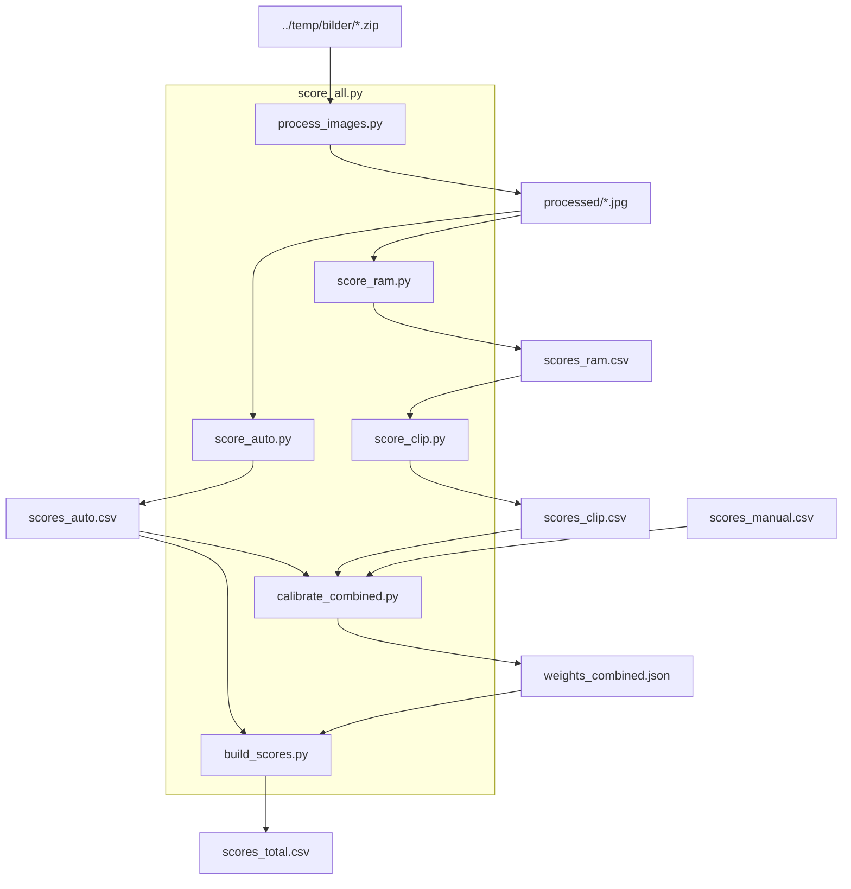

# Referanse – dataflyt, datafiler, kjente feil

Teknisk referanse for bildescoring-pipelinen og dokumentkonvertering. For prosjektets dokumenter og mapper (`bakgrunn/`, `leveranser/`, `stotte/`, osv.), se [mappestruktur.md](mappestruktur.md).

## Dataflyt

Bildescoring-pipelinen:



## Datafiler

Alle datafiler ligger i `data/`.

### `team.json` — autoritativt register over ressurspersoner og organisasjoner

Strukturert JSON med fire seksjoner:

- `personer` – ressurspersoner med rolle, organisasjon, kontaktinfo og hvor de er nevnt
- `organisasjoner` – samarbeidende firma og deres rolle i FG30
- `myndigheter_og_tilskuddsorgan` – tilskuddsgivere, kommunale/statlige etater
- `forhandsinteressenter` – aktører som har meldt interesse for utleieflate

Dokumenter som omtaler personer eller organisasjoner skal henvise til denne filen som autoritativ kilde for navn, roller og kontaktinfo. Eventuelle uoverensstemmelser rettes her først, deretter i kildedokumentet.

### `scores_auto.csv` — append-only, skrives av `score_auto.py`

| Kolonne | Beskrivelse |
|---|---|
| `filnavn` | Bildefilnavn, f.eks. `20260620_080001.jpg` |
| `sharpness_raw` | Laplacian-varians (0–∞, høyere = skarpere) |
| `exposure_raw` | Clipping-andel (0.0–1.0, lavere = bedre eksponering) |
| `brisque_raw` | BRISQUE-score (0–100, lavere = bedre teknisk kvalitet) |
| `musiq_raw` | MUSIQ-SPAQ-score (0–100, høyere = bedre estetisk kvalitet) |

### `scores_manual.csv` — fylles ut manuelt

| Kolonne | Beskrivelse |
|---|---|
| `filnavn` | Bildefilnavn |
| `score` | Manuell rating 1–10 (tom = ikke ratet ennå) |

### `scores_ram.csv` — long format, append-only, skrives av `score_ram.py`

| Kolonne | Beskrivelse |
|---|---|
| `filnavn` | Bildefilnavn |
| `tag` | Ord RAM+ har gjenkjent i bildet, f.eks. `beam`, `debris`, `pipe` |

Én rad per bilde per tag. Et bilde kan ha 5–20 rader.

### `scores_clip.csv` — long format, append-only, skrives av `score_clip.py`

| Kolonne | Beskrivelse |
|---|---|
| `filnavn` | Bildefilnavn |
| `tag` | Tag fra vokabularet (alle unike tags fra `scores_ram.csv`) |
| `clip_score` | Cosine-similaritet mellom bilde og tag (ca. 0.1–0.4) |

Hvert bilde har én rad per tag i hele vokabularet (719 tags × 1258 bilder = 904 502 rader).

### `scores_total.csv` — regenereres fullt av `build_scores.py`

| Kolonne | Beskrivelse |
|---|---|
| `filnavn` | Bildefilnavn |
| `sharpness` | Normalisert sharpness 1–10 (p5/p95) |
| `exposure` | Normalisert exposure 1–10 (p5/p95, invertert) |
| `brisque` | Normalisert BRISQUE 1–10 (p5/p95, invertert) |
| `musiq` | Normalisert MUSIQ 1–10 (p5/p95) |
| `tag_score` | Score fra `weights_tags.json` (referanse, brukes ikke i total hvis combined finnes) |
| `total` | Endelig score 1–10 – fra combined-modell hvis `weights_combined.json` finnes, ellers 50/50 auto+tag |
| `manual` | Manuell rating 1–10 (tom hvis ikke ratet) – for kvalitetskontroll mot modellscoren |

### `weights_auto.json` — skrives av `calibrate_auto.py`

Lineære regresjonskoeffisienter for de 4 auto-metrikk-scorene + intercept.

### `weights_tags.json` — skrives av `calibrate_tags.py`

Ridge-regresjonskoeffisienter for alle 719 CLIP-tags + intercept.

### `weights_combined.json` — skrives av `calibrate_combined.py`

Ridge-regresjonskoeffisienter for alle 723 features (4 auto + 719 tags). Inneholder scaler-parametrene (`mean`, `std`) per feature siden features StandardScales før regresjon. Format:

```json
{
  "intercept": 5.42,
  "features": {
    "sharpness": {"mean": 5.1, "std": 2.3, "coef": 0.18},
    "debris":    {"mean": 0.21, "std": 0.04, "coef": 0.12}
  }
}
```

## Mappestruktur – kode og data

```
fjordgata30/
├── CLAUDE.md                  – prosjektkontekst for AI
├── TASKS.md                   – oppgaveliste med status
├── README.md                  – oversikt + lenker til docs/
├── config.json                – konfigurasjon (bl.a. bilder_dir)
├── scripts/
│   ├── score_all.py        – kjør hele pipelinen i sekvens
│   ├── process_images.py      – bildeprosessering (zip → JPEG)
│   ├── score_auto.py          – råscoring, skriver scores_auto.csv
│   ├── score_ram.py           – RAM-tagging, skriver scores_ram.csv
│   ├── score_clip.py          – CLIP-scoring, skriver scores_clip.csv
│   ├── calibrate_auto.py      – kalibrering auto-metrikker, skriver weights_auto.json
│   ├── calibrate_tags.py      – kalibrering tags, skriver weights_tags.json
│   ├── calibrate_combined.py  – kombinert kalibrering, skriver weights_combined.json
│   ├── build_scores.py        – beregner scores_total.csv
│   ├── select_images.py       – velg beste bilder for en tidsperiode
│   ├── transcribe_audio.py    – WhisperX-transkribering av lydfiler i referat/nye/
│   ├── analyse_konkurrentpriser.py – vektet konkurranseanalyse, skriver konkurrent_analyse.md
│   ├── arealoversikt.py            – summerer arealer fra fg30_arealoversikt.csv (autoritativ kilde)
│   ├── extract_tegninger.py        – rasteriserer PDF-tegninger til PNG i tegninger/
│   ├── config.py              – leser config.json, eksponerer BILDER_DIR/PROCESSED_DIR/EXTRACTED_DIR
│   └── scoring/               – moduler per metrikk (sharpness, exposure, brisque, musiq)
├── data/                      – alle datafiler (scores + weights + konkurranseanalyse)
│   ├── scores_auto.csv
│   ├── scores_manual.csv
│   ├── scores_ram.csv
│   ├── scores_clip.csv
│   ├── scores_total.csv
│   ├── weights_auto.json
│   ├── weights_tags.json
│   ├── weights_combined.json
│   ├── konkurrent_priser.csv        – prisdata per konkurrent (kilde + proveniensmetadata)
│   ├── konkurrent_analyse.md        – generert rapport (analyse_konkurrentpriser.py)
│   └── comp_weights.conf            – parametere for konkurranseanalysen (Gaussisk bredde, etc.)
├── bakgrunn/                  – søknader, lovverk, bakgrunnsdokumenter (se docs/mappestruktur.md for undermapper)
├── saker/                     – indekser for flerdomene-saker (tvangsmulkt, kjeller-ra)
├── forretningsplan/           – forretningsplan, MVA-vurderinger og markedsdata
│   ├── forretningsplan.md          – fullstendig forretningsplan (bankpresentasjon)
│   ├── mva_strategi.md          – MVA-strategi og alternativer
│   ├── fg30_selskapsstruktur_mva.md     – bygge-AS vs. drifts-AS: MVA-konsekvenser (T76)
│   ├── fg30_konkurrentanalyse_valet.md  – detaljert analyse av Vinden, Box2Box, Stash (T79)
│   ├── konkurrentanalyse_og_markedsdata.md             – konkurrentanalyse og markedsdata Trondheim
│   ├── kilde_mva_regelverk.md           – lovhenvisninger og prinsipputtalelser
│   └── lover/                           – nedlastede lovtekster og prinsipputtalelser (verbatim)
│       ├── mval_2-1_registreringsplikt.md
│       ├── mval_2-3_frivillig_registrering.md
│       ├── mval_3-11_fast_eiendom.md
│       ├── mval_8-1_fradragsrett.md
│       ├── mval_8-2_forholdsvis_fradrag.md
│       ├── mval_8-6_tilbakegaende_avgiftsoppgjor.md
│       ├── mval_9-1_kapitalvarer.md
│       ├── mval_9-4_justeringsperiode.md
│       ├── prinsipputtalelse_2014_minilager.md
│       └── skatteklagenemnda_datasenter_2020.md
├── tegninger/                 – arkitekttegninger (PDF + PNG per side)
│   ├── *.pdf                              – kilde-PDFer fra SAHAA (rammesøknadsvedlegg, IG-vedlegg osv.)
│   └── 2026-05-12_E-XX_*.png              – rasteriserte enkelttegninger (ekstrahert med extract_tegninger.py)
├── stotte/                    – tilskuddsdata og støttesøknader
│   ├── project_cards.json               – strukturerte tilskuddsdata (alle ordninger)
│   ├── fg30_skattefunn_vurdering.md     – SkatteFunn vurdering og søknadsskisse (T70)
│   └── fg30_innovasjon_norge_vurdering.md – Innovasjon Norge virkemidler og søknadsskisse (T71)
└── referat/                   – møtereferater
```

Bildemapper (utenfor prosjektet):

```
../temp/bilder/
├── *.zip                  – nedlastede arkiver fra Google Drive (input)
├── extracted/             – utpakkede originaler
└── processed/             – prosesserte bilder (output fra process_images.py)
```

## Kjente feil og fallbacks

### MUSIQ-modellvekter feiler på Windows (104 MB)

`pyiqa` sin interne nedlasting via `urllib` feiler på store filer på Windows. Last ned manuelt med `requests` første gang:

> **Kjør i:** Git Bash (Windows) – fra prosjektroten, med `.venv-win` aktivert

```bash
python -c "
import requests, pathlib
url = 'https://huggingface.co/chaofengc/IQA-PyTorch-Weights/resolve/main/musiq_spaq_ckpt-358bb6af.pth'
dest = pathlib.Path.home() / '.cache/torch/hub/pyiqa/musiq_spaq_ckpt-358bb6af.pth'
dest.parent.mkdir(parents=True, exist_ok=True)
r = requests.get(url, stream=True, timeout=120)
r.raise_for_status()
open(dest, 'wb').write(b''.join(r.iter_content(8192)))
print('OK')
"
```

### `opencv-python` vs `opencv-contrib-python` kollisjon

Ikke installer `opencv-python` eller `opencv-python-headless` i samme venv som `opencv-contrib-python` – de kolliderer og bryter `cv2`-importen. Kun `opencv-contrib-python` skal være installert.

### Chromium mangler for mermaid-filter (Node 24+)

`mermaid-filter` drar inn puppeteer 19 (utdatert), og install-hooken som skulle lastet ned Chromium hopper stille over på moderne Node. Uten Chromium feiler filteret med `spawn … chrome.exe ENOENT`. Kjør nedlastingen manuelt etter `npm install -g mermaid-filter`:

> **Kjør i:** Git Bash (Windows) – juster Node-versjonen i pathen om nødvendig

```bash
cd /c/ProgramData/nvm/v<versjon>/node_modules/mermaid-filter/node_modules/puppeteer
node install.js
```

> **Kjør i:** WSL2 Ubuntu (eller native Linux) – nvm-installert Node

```bash
cd ~/.nvm/versions/node/v<versjon>/lib/node_modules/mermaid-filter/node_modules/puppeteer
node install.js
```

Sluttresultat: Chromium (~150 MB) lastet ned til `~/.cache/puppeteer/chrome/win64-<revisjon>/` (Windows) eller `~/.cache/puppeteer/chrome/linux-<revisjon>/` (Linux). Kun én gang per maskin.

**Fallback – pek til allerede installert Chrome/Edge:** Hvis manuell nedlasting feiler, kan du peke puppeteer til en systeminstallert Chromium-basert browser. Legg linjen i `~/.bashrc` for permanent effekt.

> **Kjør i:** Git Bash (Windows)

```bash
# Chrome:
export PUPPETEER_EXECUTABLE_PATH="/c/Program Files/Google/Chrome/Application/chrome.exe"
# Edge (også Chromium):
export PUPPETEER_EXECUTABLE_PATH="/c/Program Files (x86)/Microsoft/Edge/Application/msedge.exe"
```

> **Kjør i:** WSL2 Ubuntu (eller native Linux)

```bash
export PUPPETEER_EXECUTABLE_PATH=/usr/bin/google-chrome
```

### Puppeteer-Chromium mangler shared libraries (Ubuntu <22.04 / minimalinstallasjoner)

Puppeteer-Chromium trenger et sett shared libraries som normalt følger med desktop-installasjoner. Hvis mermaid-filter feiler med «missing library»:

> **Kjør i:** WSL2 Ubuntu (eller native Linux)

```bash
sudo apt install libnss3 libatk-bridge2.0-0 libxkbcommon0 libgbm1 libasound2
```

### Lange kodelinjer i PDF blir kuttet

Standard pandoc-oppsett bryter *ikke* lange linjer i kodeblokker automatisk – linjer som er bredere enn sidebredden kuttes visuelt (teksten er fortsatt intakt i output-en, men vises ikke). Dette er akseptert for dette prosjektet. Automatisk linjebryting via `fvextra`-pakken (`-V header-includes='\usepackage{fvextra}' -V header-includes='\fvset{breaklines=true,breakanywhere=true}'`) er testet, men ga uheldige brudd midt i identifikatorer (f.eks. filstier og kommandonavn). Ved behov: hold kodelinjer korte i kilden, eller aktivér fvextra ad hoc for det aktuelle dokumentet.
